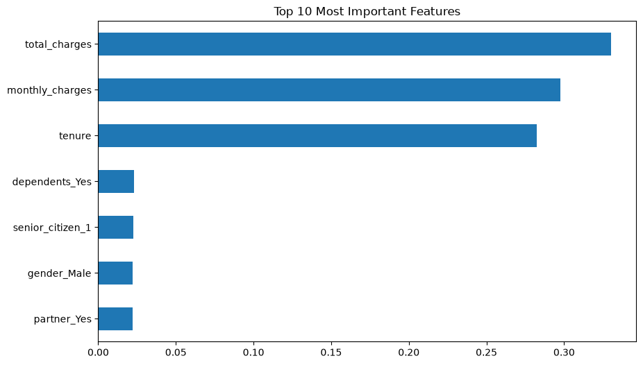
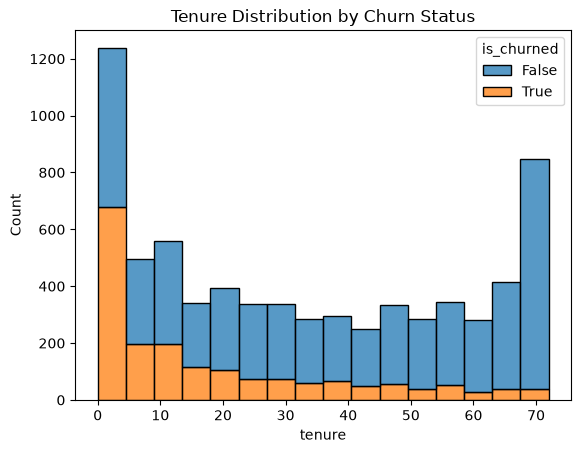

# Customer Churn Analysis

> **Summary:** An end-to-end churn project on 7,043 telecom customers: load a CSV into PostgreSQL, model it as a star schema with SQL, explore it in Python, and train a random forest to flag customers likely to leave.
>
> **Tech stack:** Python, PostgreSQL, SQL (CTEs, window functions), pandas, SQLAlchemy, scikit-learn, SHAP, matplotlib, seaborn



## Dataset

The project uses the public Telco Customer Churn dataset (7,043 customers, one row each, with a churn flag). The CSV is **not included in this repo**: download it yourself and save it as `csv_files/telco_churn.csv` (the folder is git-ignored).

## Pipeline

1. **Load:** `scripts/load_data.py` reads the CSV and writes it to a `raw_customers` table in PostgreSQL.
2. **Model:** `sql_queries/init_db.sql` and `sql_queries/transform_data.sql` build a small star schema: `dim_customer` (gender, senior citizen, partner, dependents) and `fact_churn` (tenure, monthly and total charges, churn flag).
3. **Analyze in SQL:** `sql_queries/analysis.sql` holds the retention, tenure-bucket (including a CTE version) and senior-citizen queries.
4. **Explore:** `notebooks/01_eda.ipynb` pulls the star schema into pandas for EDA.
5. **Model:** `notebooks/02_model_training.ipynb` trains and tunes a random forest and explains it with SHAP.

## Findings

From the EDA notebook:

- **26.5% of customers churned** (about 1 in 4).
- **Senior citizens churn far more:** 41.7% vs. 23.6% for non-seniors.
- **Customers without a partner churn more:** 33.0% vs. 19.7% with a partner.
- **Customers without dependents churn more:** 31.3% vs. 15.5% with dependents.
- **Churn by tenure bucket:** [ADD: run the CTE query in `sql_queries/analysis.sql` against the loaded data and paste the churn rate for each bucket (0 to 6 months, 6 to 24 months, 2+ years).]



## Model results

A random forest (100 trees, `class_weight='balanced'`) on an 80/20 split (1,409 test customers, `random_state=42`):

| Model | Features | Accuracy | Churn precision | Churn recall | Churn F1 |
|---|---|---|---|---|---|
| Random forest | 7 | 0.75 | 0.53 | 0.61 | 0.57 |
| Random forest (pruned) | 3 (`total_charges`, `monthly_charges`, `tenure`) | 0.74 | 0.51 | 0.62 | 0.56 |

- Grid search on the pruned model (5-fold CV, scored on F1) picked `max_depth=10`, `min_samples_split=10`, `n_estimators=50`, with a best CV F1 of 0.587.
- In the full model, `total_charges` (0.33), `monthly_charges` (0.30) and `tenure` (0.28) carry almost all of the importance; the four demographic dummies are about 0.02 each.
- **ROC-AUC:** [TODO: re-run `notebooks/02_model_training.ipynb` with the dataset and record the ROC-AUC printed by the new ROC cell.]

> **Note:** the numbers above are from the original notebook run, before two fixes: the notebook cast every column to integers, which truncated the decimals in `monthly_charges` and `total_charges`, and the SHAP cell paired the 7-feature model with 3-feature data. Both are fixed in the code, but the metrics need to be re-run with the dataset and updated here.

## Limitations

- The star schema only carries demographics, tenure and charges. Contract type, internet service and the other service columns from the CSV are not loaded, so the model cannot use them and is likely missing strong churn signals.
- `total_charges` is roughly `tenure × monthly_charges`, so the three top features are correlated and their individual importances should not be over-read.
- Feature importance shows what the model relies on, not what causes churn.
- Results come from a single train/test split; there is no cross-validated estimate for the final model.
- Churn precision is about 0.5, so roughly half of the customers flagged would not actually have churned.

## Run it

1. **Install:**
   ```bash
   python -m venv venv
   source venv/bin/activate        # Windows: venv\Scripts\activate
   pip install -r requirements.txt
   ```
2. **Configure the database:** copy `.env.example` to `.env` and fill in `DB_USER`, `DB_PASSWORD`, `DB_HOST`, `DB_PORT` and `DB_NAME` for an empty PostgreSQL database. `.env` is git-ignored; never commit it.
3. **Add the data:** save the Telco churn CSV as `csv_files/telco_churn.csv`.
4. **Load and transform:**
   ```bash
   python scripts/load_data.py
   ```
   Then run `sql_queries/init_db.sql` followed by `sql_queries/transform_data.sql` in your SQL client (for example `psql`).
5. **Analyze:** run the queries in `sql_queries/analysis.sql`, then open the notebooks in `notebooks/` in order.

## Repository structure

```text
customer_churn_analysis/
├── csv_files/            # Telco CSV goes here (git-ignored, not in repo)
├── docs/                 # Charts used in this README
├── notebooks/
│   ├── 01_eda.ipynb
│   └── 02_model_training.ipynb
├── scripts/
│   ├── generate_schema.py  # prints a CREATE TABLE statement from the CSV
│   └── load_data.py        # loads the CSV into PostgreSQL
├── sql_queries/
│   ├── init_db.sql         # raw table + star schema DDL
│   ├── transform_data.sql  # raw -> dim_customer / fact_churn
│   └── analysis.sql        # analysis queries
├── .env.example
└── requirements.txt
```
